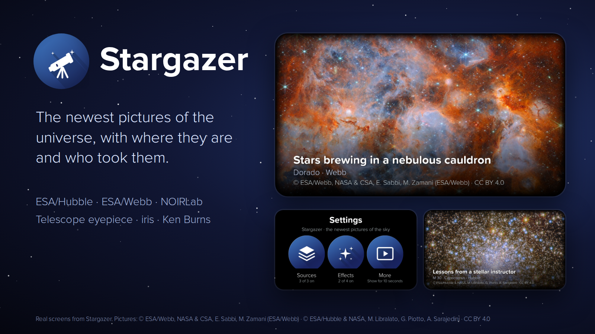

# Stargazer

Stargazer turns Jibo into a window on the universe. He shows an astronomy picture from ESA/Hubble, ESA/Webb or NOIRLab, with its name, where it is in the sky and who took it.

Stargazer needs BEam 3.1.9 or newer and an internet connection.



## Using it

1. Install **Stargazer** from BEacon's **Store → Skills**, or use **⋮ → Upload Skill ZIP** with a release's `Stargazer.zip`. It becomes a button in the main menu.
2. Open it. A telescope eyepiece appears, rises towards the top of the screen and looks around the sky, with Jibo's own telescope sounds. Its focus dial lights up as the picture loads. When the picture is in, the eyepiece settles at the top, the picture comes into focus inside the lens, and the lens opens up to the whole screen with a slow pan and zoom.
3. The caption has three lines:
   - the title;
   - what the picture shows, for example **M 30 · Capricornus · Hubble**;
   - who took it.
4. Jibo reads the title aloud. He reads only the title, never the long description.
5. After 10 seconds, Jibo's eye comes back. Touching the picture restarts that time.

Each time, Stargazer picks **one** source at random and shows its newest picture. It prefers a source that it knows has something new without downloading anything. Either that source's list is still in memory with an unseen newest picture, or the source's publishing rhythm (weekly or monthly) has passed since the last picture it showed. Only the chosen source is contacted. If it fails, Stargazer tries another one.

On the picture:
- **Tap:** shows the info overlay with a short description, the source and date, and the credit, plus a **Settings** button.
- **Swipe down:** goes back one level. On the picture it closes Stargazer.

## Settings

**Sources:** turn each source on or off. At least one stays on.

| Source | New pictures | Caption |
|---|---|---|
| ESA/Hubble Picture of the Month | monthly | object · constellation · Hubble |
| ESA/Webb Picture of the Month | monthly | object · constellation · Webb |
| NOIRLab Image of the Week | weekly | object or place · NOIRLab |

**Effects:** how a new picture appears.

| Effect | What it does | At first |
|---|---|---|
| Ken Burns | a slow pan and zoom across the picture; tall pictures are panned top to bottom | on |
| Telescope iris | Jibo's eye becomes a round lens that opens up into the picture | on |
| Look up | Jibo's eye glances up and he tilts his head towards the sky first | off |
| Starfield | stars stream out of the eye before the picture, then sparkle by the title | off |

**More:**
- **Show for:** how long the picture stays before Jibo's eye returns: 10 s, 30 s, 1 min, 5 min, or **Until I close it**.
- **Slideshow:** off, or a picture from another source every 1, 5 or 30 minutes. A running slideshow keeps Stargazer open.
- **Read title aloud:** on or off.
- **Telescope sounds:** Jibo's tripod clicks as the eyepiece moves (on). They are played from Jibo's own sound library and are not part of this skill.
- **Show caption:** on or off.

## Pictures and credits

Every picture belongs to the people and organisations named in its caption.

| Source | Licence |
|---|---|
| ESA/Hubble, ESA/Webb, NOIRLab | Creative Commons Attribution 4.0 |

Stargazer shows each picture on Jibo with its credit, and does not copy, store or share it.

## Privacy

- **Memory only:** pictures are downloaded into memory and dropped once they leave the screen. They are never saved to disk.
- **What is stored:** only your settings and a short list of picture IDs already shown, used for the "New" mark.
- **No account and no tracking.** Stargazer only asks the picture sources for their latest pictures.

## Build and test (development machine)

```sh
node --test tests/*.test.mjs                        # parsers (saved responses), settings, timers, effects
python3 tools/package.py                            # writes dist/Stargazer.zip and checks BEacon's limits
node tools/make-icons.mjs <path to playwright>      # only to redraw the icons
```

No npm or build step runs on the robot. The ZIP holds plain Node 6 JavaScript and the icons.

```
manifest.json, icon.png, banner.png, README.md   store files
stargazer/                    the @be/stargazer package (what runs on Jibo)
  lib/screen.js               the SDK view: picture layer, info overlay, menus, gestures
  lib/presenter.js            shows pictures with the effects (lib/effects/*), caption (lib/caption.js)
  lib/model.js                navigation, settings menus, "Show for" and slideshow timers
  lib/catalog.js, sources/    the picture sources; picks one source (fresh first, random) per picture
  lib/images.js, net.js       downloads into memory and decodes to textures
  lib/effects/eyepiece.js     the eyepiece that searches the sky while the picture loads
  lib/sounds.js               Jibo's telescope sounds (played from his animation library)
  lib/motion.js               "Look up" on the body
  lib/settings.js             settings.json, seen.json and sources.json (what each source showed last)
tests/, tools/                development only; not in the ZIP
```

## Licence

The code is under the MIT License (see `LICENSE`, also included in the skill folder of the ZIP). The licence covers Stargazer's code and its own icons. It does not cover the pictures: each picture keeps its own licence and credit (see Pictures and credits). No firmware art or fonts are included; the text uses the robot's own Proxima Nova.
